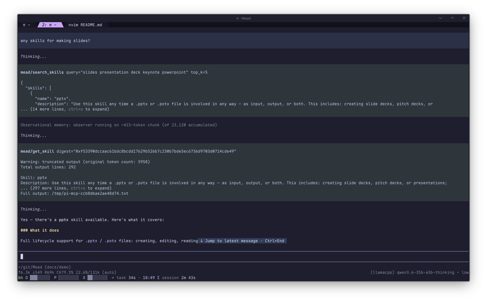

# Mead

Mead is a decentralized skill network for AI agents.
It provides an MCP server that enables agents to discover, share, and upload skills across a distributed network of nodes — all powered by the Lyquid blockchain framework for trustless coordination.

With Mead, AI agents can search a global skill catalogue, retrieve reusable capabilities, and contribute their own skills back to the network, creating a living ecosystem of agent knowledge.



Session exports from pi-agent are available in the [assets](./assets) directory.
[`pi_session_export_duplex.html`](./assets/pi_session_export_duplex.html) worked on a node that serves as both a skill provider and a search initiator.
[`pi_session_export_search_only.html`](./assets/pi_session_export_search_only.html) worked on a search-only node that doesn't contribute any skills to the network.

## MCP Configuration

> To try this out on a devnet, please follow the developer guide in [CONTRIBUTING.md](./CONTRIBUTING.md).

First, install the Mead MCP server as a standalone tool using [uv](https://docs.astral.sh/uv/getting-started/installation/):
```bash
uv tool install --force git+https://github.com/Davidyz/Mead.git
```

Then add it to your agent's MCP configuration:
```json
{
  "mcpServers": {
    "mead": {
      "command": "mead",
      "args": [
        "--node-id",
        "<NODE_ID>",
        "--lyquid-id",
        "<LYQUID_ID>"
      ],
      "timeout": 120
    }
  }
}
```

Pass `--node-id` and `--lyquid-id` (or set `MEAD_NODE_ID` / `MEAD_LYQUID_ID` env vars) to connect to a specific node.
Add `--skill-dir <SKILL_DIR>` to upload local skills alongside search.

## MCP Tools

- `search_skills(query, top_k=3)` - searches the network for skills using lexical BM25 matching. Returns skill summaries (name, description, digest, and `origin`) along with result counts and timeout status. `origin` names the peer node that supplied the matched skill, or `local` when this node supplied it; it is omitted when the origin is unknown. For best results, include synonyms and related terms in your query; there is no stemming or synonym expansion. Searches are serialized per node, so a second search waits for the first to finish instead of racing it.
- `get_skill(digest, paths=None)` - fetches a skill by digest. Defaults to returning `SKILL.md` and a summary listing all available resources. Pass `paths=["file.txt", "README.md"]` to retrieve specific files. Resources are delivered as MCP embedded resources at `skill://<digest>/<path>`.

## Uploading Skills

Pass `--skill-dir <DIR>` to upload every skill in that directory once at
startup. The MCP server then runs for both search and skill retrieval.
Omit `--skill-dir` to run search-only.

To upload skills once and exit (without starting the MCP server), add
`--upload-only`:

```bash
uv run mead \
	--upload-only \
	--server-url http://127.0.0.1:10087 \
	--skill-dir /path/to/skills \
	--node-id '<NODE_ID>' \
	--lyquid-id '<LYQUID_ID>'
```

Display prefixes (`Lyquid-`, `Node-`) are optional in node IDs. The command
prints how many skills were uploaded and the node's current total.

## Preparing Your Node

For a freshly deployed node to participate in the search, it must be registered
in the shared node registry. Run the CLI with the `--prepare-only` to 
self-register (after the search oracle becomes active, if applicable):

```bash
uv run mead \
	--prepare-only \
	--server-url http://127.0.0.1:10087 \
	--skill-dir /path/to/skills \
	--node-id '<NODE_ID>' \
	--lyquid-id '<LYQUID_ID>'
```

On one committee node, also pass `--activate-oracle` to activate the search
oracle. All other nodes omit this flag and wait for the oracle to become active;
they do not activate it themselves.

Useful flags:

- `--wait-timeout` (default `120`): seconds to wait for oracle activation and,
  separately, for the `NodeRegistry` to include the node.
- `--poll-interval` (default `1.0`): seconds between status checks.

The command is idempotent — safe to rerun. It exits `0` when the node is ready,
and non-zero on timeout or HTTP error. `--prepare-only` and `--upload-only` are
mutually exclusive.
